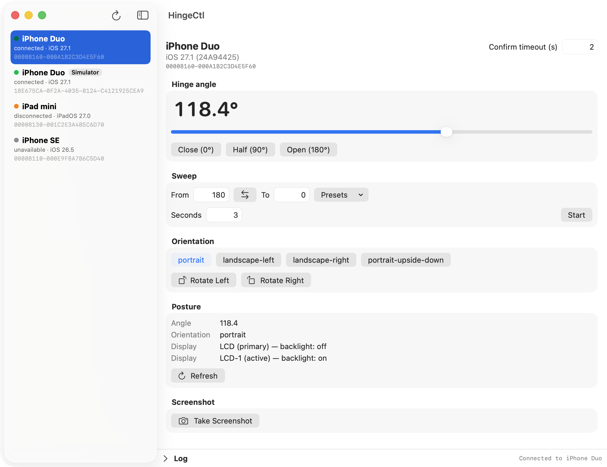

<div align="center">

<picture>
  <source media="(prefers-color-scheme: dark)" srcset="HingeCtlApp/Icon/AppIcon-dark.svg">
  
</picture>

# hingectl

**iPhone Duo のヒンジ角と画面の向きを、Mac から制御する。**

CLI と GUI。実機にも、起動中のシミュレータにも、同じ操作で。


[](LICENSE)

[クイックスタート](#クイックスタート) ·
[インストール](#インストール) ·
[コマンド](#コマンド) ·
[GUI アプリ](#gui-アプリ) ·
[デバイスの選び方](#デバイスの選び方) ·
[ドキュメント](#ドキュメント)

</div>

```console
$ hingectl set 120
$ hingectl sweep 180 90 2
$ hingectl get
90.0
$ hingectl rotate right
```

> ⚠️ **注意**: 非公開 API を使っています。Xcode / OS の更新で動かなくなる可能性があり、App Store 向けのツールではありません。

## 特長

| 機能 | 内容 |
| --- | --- |
| 🎚️ **ヒンジ角の制御** | 0°(閉)〜 180°(平ら)。`sweep` は 60Hz で連続送信します |
| 🔄 **向きの制御** | 4 方向の設定と、左右への 90° 回転 |
| 🖥️ **実機とシミュレータ** | 同じコマンド、同じ実装。`list` で並べて、UDID で選びます |
| 🪟 **GUI アプリ** | SwiftUI の 1 ウィンドウ。CLI と同じ機能と規則 |
| 🧩 **Xcode と同じ土台** | Device Hub と同じ `CoreDevice.framework` を直接呼びます |
| 🤖 **スクリプト向き** | `--json` 出力、明確な終了コード、`stdout` と `stderr` の分離 |

引数の解釈は、[swift-argument-parser](https://github.com/apple/swift-argument-parser) の標準的な文法(`hingectl <subcommand> [arguments] [options]`)です。
ヘルプとエラーを含む、ユーザー向けのメッセージは英語です。

## クイックスタート

```bash
make build                  # → .build/arm64e-apple-macosx/release/hingectl
.build/arm64e-apple-macosx/release/hingectl list
.build/arm64e-apple-macosx/release/hingectl set 120
```

GUI を使うなら:

```bash
make run-app                # ビルドして起動(要 mint)
```

> 💡 **メモ**: ビルドには **Xcode 27.0 以降(Swift 6.4)** が必要です。初回は、swift-argument-parser の取得にネットワークが必要です。

### 動作確認済みの環境

- Xcode 27.1(CoreDevice 651.13.5)。ビルドは Xcode 27.0 でも成功し、シミュレータで 27.1 と同じ結果になることを確認しています
- 実機: iPhone Duo(iOS 27.1)、USB またはネットワークで接続済み(connected)
- シミュレータ: iPhone Duo(起動中。`devicectl list devices` が `connected` として返すもの)

## インストール

ビルドした実行ファイルを、PATH の通った場所へコピーします(sudo は要りません)。

```bash
make build
mkdir -p ~/.local/bin
cp .build/arm64e-apple-macosx/release/hingectl ~/.local/bin/
```

`~/.local/bin` が PATH に無ければ、シェルの設定(`~/.zshrc` など)に足します。

```bash
export PATH="$HOME/.local/bin:$PATH"
```

GUI アプリは、`make app` で作った `HingeCtl.app` を、`/Applications` などへコピーします。

```bash
make app
cp -R .build/xcode/Build/Products/Release/HingeCtl.app /Applications/
```

配布用の DMG(アプリと、`/Applications` へのショートカットを並べたもの)は、`make dmg` で作れます(`.build/HingeCtl-<バージョン>.dmg`)。標準の `hdiutil` と `sips` だけを使います(背景画像とアイコンの配置つき)。

```bash
make dmg
```

実行には、特定の Xcode は要りません(CoreDevice は、システム共通の場所からリンクします。詳しくは [開発メモ](docs/DEVELOPMENT.md#xcode-の選ばれ方))。
署名は ad-hoc で、配布は想定していません。ビルドした Mac で使ってください。

## ビルド

```bash
make build    # arm64e の実行ファイル: .build/arm64e-apple-macosx/release/hingectl
make app      # GUI アプリ: .build/xcode/Build/Products/Release/HingeCtl.app(make run-app で、ビルドして起動。要 mint)
make test     # 純粋なロジック(HingeCtlCore)と、GUI の状態管理(HingeCtlAppKit)の単体テスト(arm64)
make clean
```

Xcode 27.0 以降が要ります。使う Xcode の決まり方は、[開発メモ](docs/DEVELOPMENT.md#xcode-の選ばれ方)を参照してください。

**`swift build` だけでは動く実行ファイルになりません。** `make build` を使ってください(理由は「[ビルドの注意](docs/DEVELOPMENT.md#ビルドの注意)」)。
swift-argument-parser(1.8.2 に固定)を SwiftPM で取得するため、**初回のビルドとテストにはネットワークが必要**です(取得後は、キャッシュで動きます)。

## コマンド

```text
hingectl <subcommand> [arguments] [options]
```

オプションは、**サブコマンドの後ろ**に置きます(`hingectl -d Duo get` のように、サブコマンドの前には置けません)。

| サブコマンド | 引数 | 説明 | オプション |
| --- | --- | --- | --- |
| `set` | `<degrees>` | ヒンジ角を設定(0 = 閉じる 〜 180 = 平ら)。0〜180 の外はエラー(丸めない) | `-d` `-t` |
| `open`(別名 `flat` `unfolded`) | なし | 180° にする | `-d` `-t` |
| `close`(別名 `closed` `folded`) | なし | 0° にする | `-d` `-t` |
| `half`(別名 `half-open`) | なし | 90° にする | `-d` `-t` |
| `sweep` | `<from> <to> [seconds]` | 2 つの角度の間を動かす(秒数は 0〜3600、既定 1 秒。60Hz で連続送信) | `-d` `-t` |
| `get` | なし | 現在のヒンジ角を表示(`--sensor` でセンサー計測角を表示) | `-d` `-j` `--sensor` |
| `posture` | なし | 角度・向き・内蔵ディスプレイの状態を表示 | `-d` `-j` |
| `screenshot` | `<path>` | UI を載せているディスプレイの PNG を保存(`.png` のパス) | `-d` `-j` |
| `rotate` | `<direction>` | 90° 回転(`left` / `right`、`l` / `r` も可。Device Hub の Rotate Left / Right と同じ順序) | `-d` `-t` |
| `orient` | `<orientation>` | 向きを設定: `portrait` / `landscape-left` / `landscape-right` / `portrait-upside-down` | `-d` `-t` |
| `orientation` | なし | 現在の向きを表示 | `-d` `-j` |
| `watch` | なし | ヒンジ角の変化を表示(Ctrl-C で終了)。`--count <N>` で、N 回で終了(`--sensor` でセンサー計測角を表示) | `-d` `-j` `--sensor` `--count` |
| `list` | なし | 実機と、起動中のシミュレータを一覧表示。シミュレータの行には `[simulator]` が付き、`--json` には `reality`(`physical` / `simulated`)が出る | `-j` |

| オプション | 説明 |
| --- | --- |
| `-d, --device <device>` | 対象のデバイス(実機またはシミュレータ)。ハードウェア UDID・CoreDevice の識別子(大文字小文字を区別しない)・名前(完全一致、大文字小文字も区別)。省略時は `$HINGECTL_DEVICE`、なければ、接続中の**ヒンジ対応のデバイス**から選ぶ([デバイスの選び方](#デバイスの選び方))。ヒンジに対応していないデバイスも、明示すれば、ヒンジを使わないコマンドを実行できる |
| `-t, --timeout <seconds>` | 角度・向きが反映されるのを待つ秒数(既定 2。0〜3600 の外はエラー)。`0` で確認せずに送るだけ。角度・向きを変えるサブコマンドにだけある |
| `-j, --json` | JSON で出力する。出力のあるサブコマンドにだけある(`set` などに付けると、不明なオプションとして拒否される)。角度には物理角(`mechanicalAngle`)とセンサー角(`sensorAngle`)が含まれる |
| `--sensor` | 物理ヒンジ角(`mechanicalAngle`)ではなく、内蔵センサーが検出・推定した角度(`sensorAngle`)を出力する。`get` と `watch` にある |
| `--count <N>` | 指定した回数だけ読み取りを出力して終了する(正の整数)。`watch` にある |

ほかに、`-h, --help`、`--version`、`help <subcommand>`(いずれも標準)があります。引数なしの `hingectl` は、ヘルプを表示します(終了コード 0)。

### 例

```bash
hingectl set 120                    # 120° に設定(2 秒以内に反映されなければエラー)
hingectl open                       # 平らに開く
hingectl sweep 180 90 2             # 2 秒かけて 180° から 90° へ
hingectl get                        # 90.0
hingectl get --json                 # {"mechanicalAngle":90,"sensorAngle":94.6}
hingectl orient landscape-left      # 横向き
hingectl rotate right               # 右へ 90° 回転
hingectl posture                    # 角度・向き・ディスプレイ
hingectl screenshot shot.png        # UI を載せているディスプレイを保存
hingectl posture --device 00008160-000A1B2C3D4E5F60 --json
HINGECTL_DEVICE=Duo hingectl get    # 環境変数で対象を指定
```

### 終了コード

| 終了コード | 内容 |
| --- | --- |
| `0` | 成功、ヘルプ、`--version` |
| `64` | 引数の誤り(不明なサブコマンド・オプション、足りない引数、不正な値、範囲外の角度、`.png` でないパス など)。メッセージには、使い方が付きます |
| `1` | 実行時のエラー(該当する実機が無い、接続されていない、送信に失敗した など) |

エラーは、標準エラーに `Error: <message>` と出ます。

負の数(`set -5`)は、オプションと見なされ、`Missing expected argument '<degrees>'` になります(`set -- -5` なら、範囲外のエラー)。
どちらも有効な角度ではないため、特別な処理は入れていません。数値の表記は、ArgumentParser(`Double`)に従います(`1e2` なども受けます)。

## シミュレータ

起動中の iPhone Duo シミュレータも、実機と同じコマンドで操作できます。`list` に `[simulator]` 付きで出る UDID を、`-d` に渡します。

```bash
hingectl list                                        # 実機の後ろに、起動中のシミュレータが並ぶ
hingectl get -d 18E675CA-0F2A-4035-8124-C4121925CEA9 # シミュレータのヒンジ角
hingectl sweep 0 180 3 -d <UDID>                     # シミュレータでも同じ
```

- 対象になるシミュレータは、**起動中(`connected`)のものだけ**です。起動していないシミュレータの UDID を渡すと、`No device matches` になります。
- 名前での指定は、**同名のデバイスがあると曖昧**になります。実機の名前は、設定アプリでユーザーが変更できるため、シミュレータと同じ名前(例: どちらも `iPhone Duo`)になりえます。同名なら `Several devices match` のエラーになり、候補の UDID が表示されます。取り違えを避けるには、UDID で指定してください。名前は、大文字小文字を区別して一致させます。
- 角度の設定・`sweep`・向き・`posture`・`screenshot`・`watch` は、実機と同じ実装で動きます(CoreDevice のシミュレータ用プロバイダ経由。実機と同じ capability を持ちます)。待ち時間などの定数も、そのままで動作しました(確認した範囲: 角度の設定と読み戻し、`-t 0`、`sweep`(`from` への移動を含む)、向きの設定と `rotate`、`screenshot`)。
- シミュレータを許可した `DeviceManager` は、シミュレータを評価するとき(`-d` 省略で、起動中のシミュレータがあるとき、または `-d` でシミュレータを指定したとき)だけ作ります。実機を `-d` で指定したときは、従来と同じ経路です。

## デバイスの選び方

`-d` を省略したときの対象は、**ヒンジに対応したデバイス(iPhone Duo の実機・シミュレータ)**です。接続中のデバイスから、対応しているものを調べて選びます。
接続中の対応デバイスが 1 台も無いときだけ、切断中のデバイスを起こして調べ直します。

| 対応するデバイスの数 | 動作 |
| --- | --- |
| 1 台(実機 1 台、またはシミュレータ 1 台) | それを対象にする |
| 2 台以上(実機とシミュレータの混在、同種が複数、など) | **端末なら、番号を選ばせる**(標準エラーに候補を表示し、標準入力から読む。`q` で中止)。端末でない(パイプ・スクリプトなど)場合は、入力待ちで止まらず、候補を示して終了コード 1 のエラー |
| 0 台 | 切断中のデバイスを起こして調べ直す(下の「接続状態と、切断中のデバイス」)。それでも 0 台なら、エラー(接続中のデバイスを示す)。`screenshot` などでも、`-d` が必要 |

```text
$ hingectl get
Several connected devices support the hinge:
  1) 00008160-000A1B2C3D4E5F60  iPhone Duo
  2) 18E675CA-0F2A-4035-8124-C4121925CEA9  iPhone Duo  [simulator]
Select a device [1-2] (q to cancel): 2
180.0
```

問い合わせの表示は標準エラーに出るので、標準出力(`get` の値など)には混ざりません。`$HINGECTL_DEVICE` や `-d` を指定すれば、問い合わせません。

<details>
<summary><b>接続状態と、切断中のデバイス</b></summary>

<br>

実機は、USB でつないでいても、しばらく使わないと、接続(トンネル)が切れます。`list` の状態は、`devicectl` の `tunnelState` です。

| 状態 | 意味 | hingectl の扱い |
| --- | --- | --- |
| `connected` | つながっている | そのまま使う |
| `disconnected` | 経路(USB・ネットワーク)はあるが、いまは切れている | **必要なときに、hingectl が起こす**(下記) |
| `unavailable` | 経路が無い(ケーブルが抜けている、圏外など) | 起こさない。`-d` で指定すると `is not reachable` のエラー |

- **起こす条件**: `-d`(または `$HINGECTL_DEVICE`)で指定したデバイスが、経路のある切断中のものなら、常に起こします(経路が無い `unavailable` などは、起こさず、すぐエラーになります)。`-d` を省略したときは、接続中に対応デバイスが 1 台も無い場合に限り、経路のある切断中のデバイスを起こして、調べ直します(接続中の対応デバイスがあれば、切断中のものには触れません)。`list` は起こしません(状態をそのまま表示します)。
- **`-d` 省略時に起こす順序**: ヒンジ対応の**見込みがある**デバイスを、先に起こします。見込みは、`devicectl list devices` の `capabilities` に、向きの遠隔操作(`remote.devicecontrol.orientation`)があるかで決めます。切断中の一覧には、ヒンジ用の機能(`monitormotion` など)は載らず、この機能だけが載ります(実測: 切断中の一覧で、iPhone Duo にだけあり、経路のある iPad mini・iPad 10th・iPhone 15 Pro・iPhone SE には無し。iPhone SE も、接続中の一覧には、この機能と `monitormotion` などが載ります)。**デバイスの名前や機種名は使いません**。そこで対応デバイスが見つかれば、他の切断中のデバイスは起こしません。見つからなければ、残りも起こします。
  - これは起こす**順序**の手がかりで、判定ではありません。切断中の一覧に載る条件は分かっておらず、ヒンジ対応でも載らないデバイスや、ヒンジの無いデバイスで載るものがありえます(前者は 2 段目で見つかり、後者は、起こしたあとの判定で除かれます)。対応しているかの判定は、起こした(接続した)あとの問い合わせだけで行います。
- **起こし方**: `devicectl device info details` を、上限 10 秒(`--timeout 10`)で呼びます。起こす前に、標準エラーに `connecting to <name>...` と出ます。つながらなければ、`could not connect to <name>` の警告を出し、そのデバイスは候補に含めません(`-d` で指定していれば、`is not connected` のエラー)。
- **なぜ起こすのか**: CoreDevice の API(ヒンジ角・向き)は、自分では接続を張りません。しかも、切断中は、ヒンジ対応のデバイスにも「非対応」(`errorCode: 1001`)と返します。
  接続を確かめずに呼ぶと、対応デバイスを「ヒンジ非対応」と誤って断定するため、`devicectl`(必要なときに自分で接続を張る)で、先に接続を起こします。
- 起こしたあと、実行中に再び切れた場合(長い `watch` など)の再接続は行いません。

</details>

<details>
<summary><b>ヒンジに対応していないデバイス(iPhone SE、iPad など)</b></summary>

<br>

`-d` で明示すれば、選べます。

- ヒンジを使うコマンド(`set` / `open` / `close` / `half` / `sweep` / `get` / `watch`)は、**何も送らずに**エラーです(`<name> does not support the hinge`。`-t 0` でも同じ)。
- ヒンジを使わないコマンド(`screenshot` / `rotate` / `orient` / `orientation` / `posture`)は、実行できます。`posture` は、読めない項目(角度など)を `unavailable`(JSON は `null`)として、読めたものを表示します。向き・ディスプレイが読めない場合は、標準エラーに警告を出します。**ヒンジ対応のデバイスでは、角度・向き・ディスプレイのどれかが読めなければエラー**(終了コード 1。読めた項目も出力されません)です。`unavailable`(JSON は `null`)の角度は、ヒンジ非対応のデバイスだけです。ヒンジに対応しているかどうかの問い合わせ自体が失敗した場合も、対応デバイスと同じく厳格に扱い、警告を出します(一時的な失敗を、非対応として黙って省かないため)。

</details>

## GUI アプリ

`HingeCtlApp/` に、CLI と同じ機能を持つ SwiftUI のアプリ(`HingeCtl.app`)があります。ウィンドウ 1 枚で、左がデバイスの一覧(実機・シミュレータ、接続状態)、
右が選んだデバイスの操作です。CoreDevice を、CLI と同じ `HingeCtlDevice` で、プロセス内から直接呼びます(`hingectl` を子プロセスで呼ぶのではありません)。

<picture>
  <source media="(prefers-color-scheme: dark)" srcset="docs/images/gui-dark.png">
  
</picture>

*画面は、モックのデータで自動生成しています([開発メモ](docs/DEVELOPMENT.md#スクリーンショットの自動生成))。*

```bash
make run-app    # ビルドして起動(Xcode 27.0 以降。CLI と同じく、Scripts/with-xcode.sh が Xcode を決める)
```

| 画面 | CLI |
| --- | --- |
| ヒンジ角の表示(購読で常時更新、センサー角の併記)・数値の直接入力・スライダー・Close / Half / Open | `watch` / `set` / `open` / `half` / `close` |
| Sweep(From / To / Seconds、途中で停止できる) | `sweep` |
| 向き(4 つ)・Rotate Left / Right | `orient` / `rotate` / `orientation` |
| Posture(角度・向き・ディスプレイ) | `posture` |
| Screenshot(プレビュー・保存) | `screenshot` |
| 確認のタイムアウト(0 なら確認せずに送る) | `-t` |

- **CLI と同じ規則**: ヒンジを使う操作は、`supported` のデバイスだけで使えます(非対応・不明のデバイスでは、理由を表示して無効にします)。
  `posture` と `screenshot` は、非対応のデバイスでも使えます。値の範囲(角度 0〜180、タイムアウト・sweep の秒数 0〜3600)は、CLI と共通です(`HingeLimits`)。
- **ヒンジ角の入力**: スライダー操作のほか、角度の数値部分をクリックしてキーボードから数値を直接入力・設定できます(全角数字の半角自動正規化・範囲チェックつき)。物理角とセンサー角に差がある場合は `(sensor: ...)` を併記します。
- **切断中のデバイス**: 選ぶと、CLI と同じく、接続を張ってから開きます。つながらない(`unavailable`)デバイスは、選べません。
- **切れたあとの復帰**: 購読が切れたとき(切断・スリープなど)や、対応の問い合わせが失敗したままのときは、「Reconnect」ボタンが出ます。開き直し(切断中なら起こす)で復帰します。購読が切れたあとの角度は、古い値なので、薄く表示します。
- **スライダー**: ドラッグ中は約 60Hz に間引いて送り、ドラッグを離したときに、最後の値を送って流し切ります。プリセットのボタンは、`set` と同じく、到達を確認します。
- **ログ欄**: 接続中の表示などのメッセージ、警告、操作の失敗が出ます。

## ドキュメント

- [実機での挙動と注意点](docs/BEHAVIOR.md): 実機で確かめた、待ち時間や反映のしかた
- [開発メモ](docs/DEVELOPMENT.md): Xcode の選ばれ方、ファイル構成、テスト、仕組み、ビルドの注意、GUI の開発
- [Tools/HingeTestApp](Tools/HingeTestApp): 検証用のテストアプリ

## ライセンス

[MIT](LICENSE)
